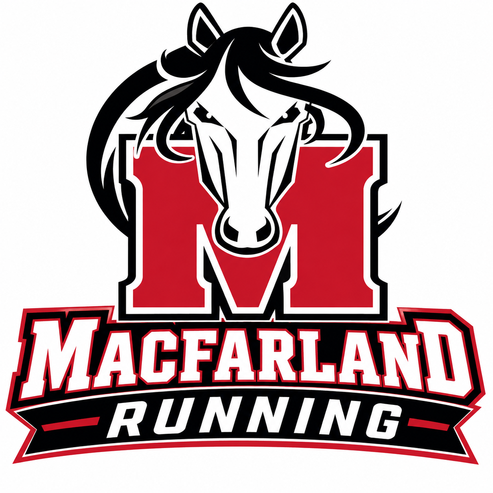

:::: {.columns}

::: {.column width="56%"}

::: callout-box
**Para ver esta página en español, haga [clic aquí](index_espanol.qmd).**
:::

**Click a link here to jump down the page.**

- [Joining the Team](#joining) - health forms, consent forms, emergency contacts
- [What to Expect](#expect) — a guide for new athletes and parents
- [Practice Schedule](#practice) — days, times, and location
- [Meet Schedule](#meets) — dates and locations
- [Contact](#contact) — reach the coaching staff

:::

::: {.column width="4%"}
:::

::: {.column width="40%"}
{fig-alt="Team photo of the 2026 squad"}
:::

::::

## Joining the Team {#joining}

### Required Forms

::: callout-box
**No athlete may practice or compete without a complete file on record with the athletic office.** Turn in all forms via the online system (see below) or to your coach.
:::

All forms can be filled out and submitted online [here](https://dcgov.seamlessdocs.com/f/hxh7r9lr32gf){target="_blank"}. This is the preferred way to submit forms. However, forms can be scanned and emailed to [MacFarland.Athletics@k12.dc.gov](mailto:MacFarland.Athletics@k12.dc.gov) (please indicate the sport in the email).

A complete packet must include:

1.  [**Universal Health Certificate (UHC)**](https://www.thedciaa.com/_files/ugd/98fcc7_f2fea093359540dcb4c6758fbb647135.pdf){target="_blank"} — must be signed by a physician, dated within the last 12 months
2.  [**All other paperwork in Participation Packet**](https://dcgov.seamlessdocs.com/f/hxh7r9lr32gf){target="_blank"}

Blank forms are also available at the front office or from your coach.

## What to Expect When Joining the Team {#expect}

### Our Team Values

**We are a team first!** Every individual contributes in some way to the overall team's score at a meet. Every athlete, from first-timers to returning runners, has a place on this team. Individually, we will focus on effort, teamwork, and improvement — not just a top place in a race. At the beginning of each season we will collectively create a team pact and individual "contracts" that will outline team and personal goals.

### For New Athletes

Joining track or cross country for the first time can feel like a lot — here's what a typical week looks like and how to prepare.

### A Typical Practice

- **Warm-up:** dynamic stretching and a short jog (10 min)
- **Main set:** running drills, intervals, or a distance run depending on the day
- **Cool-down:** easy jog and static stretching
- **Team time:** announcements and encouragement from coaches

### Your First Meet

Meets can be exciting and a little overwhelming at first. Coaches will walk every athlete through:

- Where to check in and warm up
- What event(s) they're running
- Where to wait between events
- How scoring works (it's about the team, not just individual results!)

### For Parents

- Practices happen even in light rain or snow — dress your athlete for the weather
- Encourage rest and hydration the night before meets
- Cheering is welcome and appreciated at all meets
- Questions about playing time, events, or training should go to the coach directly

## Current Practice Schedule (Winter Running Club) {#practice}

MacFarland does not currently have an indoor track team. Therefore, we are currently having **Winter Running Club**. Consider this off-season workouts to get us prepared for outdoor spring track.

::: callout-box
Practice is **rain or shine**. If we are unable to practice outside do to weather or heat, we will practice indoors. Practice is cancelled only if school itself is cancelled or closes early. 
:::

| Day         | Time        | Focus               |
|-------------|-------------|---------------------|
| Monday      | No practice | Rest day            |
| Tuesday     | 3:30–5:30pm | Running workout     |
| Wednesday   | No practice | Rest day            |
| Thursday    | 3:30–5:30pm | Strength & Skills   |
| Friday      | No practice | Rest day            |
| Sat or Sun  | On Your Own | 20-30 min easy run  |

**We will have some optional practices on weekends or when school is out**

### What to Bring to Practice

- Running shoes (no spikes at practice)
- Weather-appropriate workout clothes
- Water bottle
- Beach towel or yoga mat
- Watch with timer (optional)
- A snack for before practice

## Meet Schedule {#meets}

::: callout-box
During Winter Running Club there will be some optional indoor track meets to attend that are outside of MacFarland athletics. Please reach out to Coach Gallo to learn more about these options
:::

| Date        | Time        | Location            |
|-------------|-------------|---------------------|
| TBD         | TBD         | TBD                 |

::: callout-box
Athletes ride the bus **to and from** all  meets unless otherwise noted.
:::

### Meet Day Checklist

- Students must attend school on day of meet
- Bus departure time will vary and will be communicated with the students
- Uniforms will be provided the day of the meet
- Bring water, snacks, and clothing layers for waiting between events
- Spikes are optional but must be checked with a coach before use

### Parent Spectators

Parents are welcome at all meets. In some cases tickets are required.

## Contacts {#contact}

### Coaching Staff

| Name              | Role              | Email                           |
|-------------------|-------------------|---------------------------------|
| Travis Gallo      | Coach             | htravisgallo@gmail.com          |
| Robert Ellison    | Coach             | robert.ellison@k12.dc.gov       |
| Harold Green      | Athletic Director | MacFarland.Athletics@k12.dc.gov |

### Stay Updated

We share weather delays, schedule changes, and reminders through the parent's WhatsApp group. Join through this [link](https://chat.whatsapp.com/Gv2yzE2UP6UDWYnAmfekJI?mode=gi_t){target="_blank"}

### General Questions

For questions about paperwork, schedules, or eligibility, contact the athletic office at [MacFarland.Athletics@k12.dc.gov](mailto:MacFarland.Athletics@k12.dc.gov).

