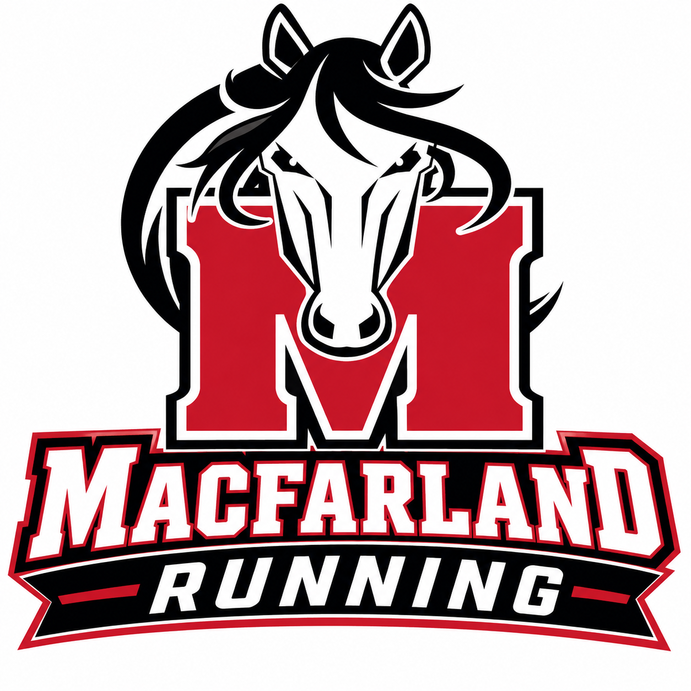

:::: {.columns}

::: {.column width="66%"}

**Haz clic en un enlace para ir directamente a esa sección.**

- [Cómo unirse al equipo](#joining) - formularios de salud, formularios de consentimiento, contactos de emergencia
- [Qué esperar](#expect) — una guía para atletas nuevos y padres de familia
- [Horario de prácticas](#practice) — días, horarios y lugar
- [Calendario de competencias](#meets) — fechas y sedes
- [Contacto](#contact) — comunícate con el cuerpo de entrenadores

:::

::: {.column width="4%"}
:::

::: {.column width="30%"}
{fig-alt="Foto del equipo de la generación 2026"}
:::

::::

## Cómo unirse al equipo {#joining}

### Formularios requeridos

::: callout-box
**Ningún atleta puede practicar ni competir sin un expediente completo en la oficina de deportes.** Entrega todos los formularios mediante el sistema en línea (ver abajo) o directamente a tu entrenador.
:::

Todos los formularios se pueden llenar y enviar en línea [aquí](https://dcgov.seamlessdocs.com/f/8efa5fkavu2u){target="_blank"}. Esta es la forma preferida de entregarlos. Sin embargo, también se pueden escanear y enviar por correo electrónico a [MacFarland.Athletics@k12.dc.gov](mailto:MacFarland.Athletics@k12.dc.gov) (por favor, indica el deporte en el correo).

Un paquete completo debe incluir:

1.  [**Certificado Universal de Salud (UHC)**](https://www.thedciaa.com/_files/ugd/98fcc7_91bf29522bee43d79e446ee2d44310b1.pdf){target="_blank"} — debe estar firmado por un médico y con fecha de los últimos 12 meses
2.  [**Todos los demás documentos del Paquete de Participación**](https://www.thedciaa.com/_files/ugd/98fcc7_91bf29522bee43d79e446ee2d44310b1.pdf){target="_blank"}

También hay formularios en blanco disponibles en la oficina principal o con tu entrenador.

## Qué esperar al unirse al equipo {#expect}

### Los valores de nuestro equipo

**¡Somos un equipo primero!** Cada persona contribuye de alguna manera a la puntuación total del equipo en una competencia. Todos los atletas, desde quienes participan por primera vez hasta quienes regresan, tienen un lugar en este equipo. De manera individual, nos enfocaremos en el esfuerzo, el trabajo en equipo y la mejora, no solo en obtener los primeros lugares. Al inicio de cada temporada crearemos juntos un pacto de equipo y "contratos" individuales que establecerán las metas del equipo y las personales.

### Para atletas nuevos

Unirse por primera vez a atletismo o campo traviesa puede parecer abrumador. Aquí te explicamos cómo es una semana típica y cómo prepararte.

### Una práctica típica

- **Calentamiento:** estiramiento dinámico y un trote corto (10 min)
- **Parte principal:** ejercicios de técnica, intervalos o una carrera de distancia, según el día
- **Enfriamiento:** trote suave y estiramiento estático
- **Tiempo de equipo:** anuncios y palabras de ánimo de los entrenadores

### Tu primera competencia

Las competencias pueden ser emocionantes y un poco abrumadoras al principio. Los entrenadores guiarán a cada atleta en:

- Dónde registrarse y calentar
- Qué prueba(s) correrá
- Dónde esperar entre pruebas
- Cómo funciona la puntuación (¡se trata del equipo, no solo de los resultados individuales!)

### Para los padres de familia

- Las prácticas se realizan incluso con lluvia ligera o nieve; vista a su atleta de acuerdo con el clima
- Fomenten el descanso y la hidratación la noche previa a las competencias
- Los ánimos de la porra son bienvenidos y apreciados en todas las competencias
- Las preguntas sobre tiempo de participación, pruebas o entrenamiento deben dirigirse directamente al entrenador

## Horario actual de prácticas (Club de Atletismo de Invierno) {#practice}

MacFarland actualmente no tiene un equipo de pista bajo techo. Por lo tanto, por ahora tenemos el **Club de Atletismo de Invierno**. Considera estos entrenamientos como preparación de la temporada baja para llegar listos al atletismo de primavera al aire libre.

::: callout-box
Las prácticas se realizan **llueva o truene**. Si no podemos practicar al aire libre debido al clima o al calor, practicaremos bajo techo. La práctica se cancela solo si la escuela se cancela o cierra temprano.
:::

| Día         | Horario     | Enfoque                    |
|-------------|-------------|----------------------------|
| Lunes       | Sin práctica | Día de descanso           |
| Martes      | 3:30–5:30 p. m. | Entrenamiento de carrera |
| Miércoles   | Sin práctica | Día de descanso           |
| Jueves      | 3:30–5:30 p. m. | Fuerza y habilidades   |
| Viernes     | Sin práctica | Día de descanso           |
| Sáb. o dom. | Por tu cuenta | Carrera suave de 20 a 30 min |

**Habrá algunas prácticas opcionales los fines de semana o cuando no haya clases**

### Qué llevar a la práctica

- Zapatos para correr (sin clavos en las prácticas)
- Ropa deportiva adecuada para el clima
- Botella de agua
- Toalla de playa o tapete de yoga
- Reloj con cronómetro (opcional)
- Un bocadillo para antes de la práctica

## Calendario de competencias {#meets}

::: callout-box
Durante el Club de Atletismo de Invierno habrá algunas competencias opcionales de pista bajo techo, organizadas fuera del programa deportivo de MacFarland. Comunícate con el entrenador Gallo para obtener más información sobre estas opciones.
:::

| Fecha       | Horario     | Lugar               |
|-------------|-------------|---------------------|
| Por definir | Por definir | Por definir         |

::: callout-box
Los atletas viajan en autobús **de ida y de regreso** en todas las competencias, a menos que se indique lo contrario.
:::

### Lista de verificación para el día de la competencia

- Los estudiantes deben asistir a la escuela el día de la competencia
- La hora de salida del autobús variará y se comunicará a los estudiantes
- Los uniformes se entregarán el día de la competencia
- Lleva agua, bocadillos y capas de ropa para los tiempos de espera entre pruebas
- Los zapatos con clavos son opcionales, pero deben ser revisados por un entrenador antes de usarlos

### Padres como espectadores

Los padres de familia son bienvenidos en todas las competencias. En algunos casos se requieren boletos.

## Contactos {#contact}

### Cuerpo de entrenadores

| Nombre            | Puesto                  | Correo electrónico              |
|-------------------|-------------------------|---------------------------------|
| Travis Gallo      | Entrenador              | [htravisgallo@gmail.com](mailto:htravisgallo@gmail.com)          |
| Robert Ellison    | Entrenador              | [robert.ellison@k12.dc.gov](mailto:robert.ellison@k12.dc.gov)       |
| Harold Green      | Director de Deportes    | [MacFarland.Athletics@k12.dc.gov](mailto:MacFarland.Athletics@k12.dc.gov) |

### Mantente informado

Compartimos retrasos por clima, cambios de horario y recordatorios a través del grupo de WhatsApp de padres de familia. Únete mediante este [enlace](https://chat.whatsapp.com/Gv2yzE2UP6UDWYnAmfekJI?mode=gi_t){target="_blank"}

### Preguntas generales

Si tienes preguntas sobre documentos, horarios o elegibilidad, comunícate con la oficina de deportes en [MacFarland.Athletics@k12.dc.gov](mailto:MacFarland.Athletics@k12.dc.gov).
